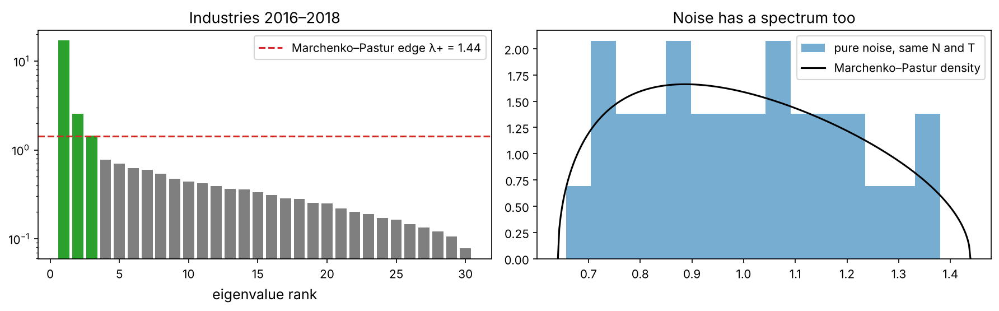
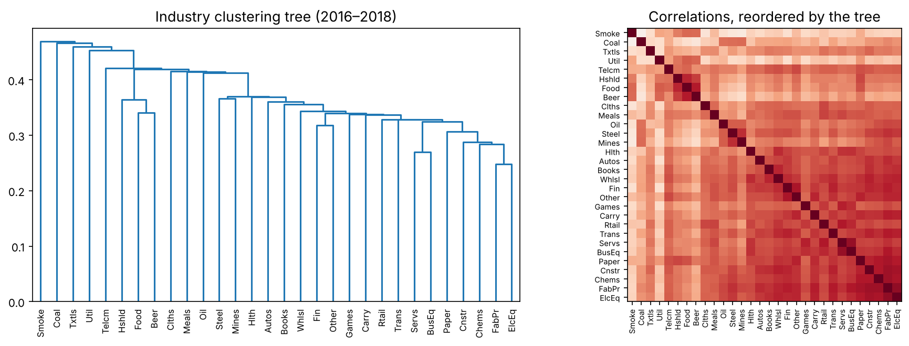
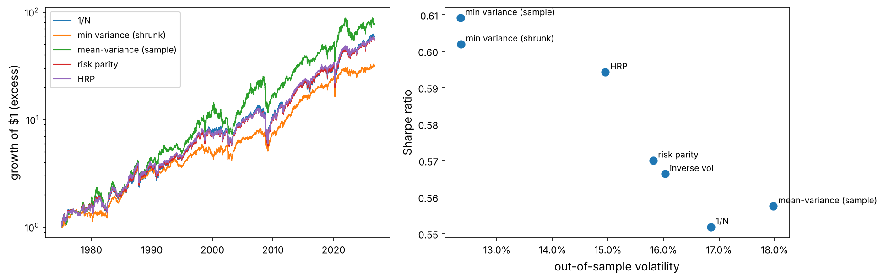

Given a set of assets, how much should you hold of each? Harry Markowitz answered in 1952 with mathematics so elegant that it won a Nobel prize and still sits in every textbook: choose the weights that give the highest expected return for each level of risk. The catch is that the formula needs the expected returns and covariances of the assets, and we only ever have *estimates*. This project measures what that catch costs, and builds portfolios that survive it.

:::eli5
Imagine you must pack a lunchbox for a whole year using only last week's weather to guess what food will stay fresh. A clever packing plan that relies exactly on last week's numbers will go wrong as soon as the weather changes. A simple, sturdy plan (a bit of everything, nothing that spoils easily) works better in practice. Portfolio optimisation is the same: the cleverer the plan, the more it trusts noisy numbers.
:::

## Look at the big picture

**The problem.** Allocate a long-only portfolio across the 30 US industry portfolios of Kenneth French's data library, rebalancing monthly, using only information available at each rebalance date. **Measures:** out-of-sample volatility and Sharpe ratio, maximum drawdown, turnover (a proxy for costs), and **concentration** (the effective number of holdings, $1/\sum_i w_i^2$). **Benchmarks:** the equally weighted portfolio (“1/N”), famously hard to beat out of sample (DeMiguel, Garlappi and Uppal, 2009).

**Why industries?** They are diversified portfolios themselves, so we avoid survivorship bias (no stock disappears from the data) and have 60 years of daily data, enough for a long walk-forward test.

## Get the data

```python
import numpy as np
import pandas as pd
import matplotlib as mpl
import matplotlib.pyplot as plt
import matplotlib.ticker as mtick
from pathlib import Path
from scipy import optimize, stats
from scipy.cluster.hierarchy import linkage, leaves_list, dendrogram
from scipy.spatial.distance import squareform
import json, time, warnings
warnings.filterwarnings("ignore")

mpl.rc("axes", labelsize=12, titlesize=13); mpl.rc("figure", dpi=110)
IMAGES = Path("images"); IMAGES.mkdir(exist_ok=True)
DATA = Path("datasets")
def save_fig(name):
    plt.tight_layout(); plt.savefig(IMAGES / f"{name}.png", dpi=150, bbox_inches="tight")
R = {}

ind = pd.read_csv(DATA / "industry30_daily_vw.csv", index_col="date", parse_dates=True)
ff = pd.read_csv(DATA / "ff_factors_daily.csv", index_col="date", parse_dates=True)
ex = ind.sub(ff["rf"], axis=0)                             # daily excess returns
print(ind.shape, ind.index[0].date(), "→", ind.index[-1].date())
print(list(ind.columns))
```

## The theory: the efficient frontier, from scratch

:::math
Let $\mu$ be the vector of expected (excess) returns and $\Sigma$ the covariance matrix of $N$ assets. A portfolio $w$ has mean $w^\top\mu$ and variance $w^\top\Sigma w$. The **minimum-variance portfolio for a target mean** $m$ solves

$$\min_w \tfrac12 w^\top\Sigma w \quad \text{s.t.} \quad w^\top\mu = m, \quad w^\top\mathbf 1 = 1.$$

With Lagrange multipliers the first-order condition is $\Sigma w = \lambda_1\mu + \lambda_2\mathbf 1$, so $w = \Sigma^{-1}(\lambda_1\mu + \lambda_2\mathbf 1)$. Define the scalars $A = \mathbf 1^\top\Sigma^{-1}\mathbf 1$, $B = \mathbf 1^\top\Sigma^{-1}\mu$, $C = \mu^\top\Sigma^{-1}\mu$ and $D = AC - B^2$. Solving the two constraints gives the **frontier**, a parabola in mean–variance space:

$$\sigma^2(m) = \frac{A m^2 - 2Bm + C}{D}.$$

Two portfolios on it matter most: the **global minimum-variance (GMV)** portfolio $w_{\text{gmv}} = \Sigma^{-1}\mathbf 1 / A$, which needs no expected returns at all, and the **tangency** portfolio $w_{\text{tan}} = \Sigma^{-1}\mu / B$, which has the highest Sharpe ratio, $\sqrt{C}$ (for excess returns).
:::

```python
def frontier(mu, S, ms):
    Si = np.linalg.inv(S); one = np.ones(len(mu))
    A, B, C = one @ Si @ one, one @ Si @ mu, mu @ Si @ mu
    D = A * C - B**2
    return np.sqrt((A * ms**2 - 2 * B * ms + C) / D)

def gmv(S):
    x = np.linalg.solve(S, np.ones(len(S))); return x / x.sum()

def tangency(mu, S):
    x = np.linalg.solve(S, mu); return x / x.sum()

# "true" parameters: estimated on the full 60 years (our best guess of the truth, for the illustration)
mu_full = ex.mean().to_numpy() * 252
S_full = ex.cov().to_numpy() * 252
w_t = tangency(mu_full, S_full)
print(f"full-sample tangency: Sharpe {mu_full @ w_t / np.sqrt(w_t @ S_full @ w_t):.2f}, "
      f"weights from {w_t.min():.2f} to {w_t.max():.2f}, sum of |w| = {np.abs(w_t).sum():.1f}")
print(f"equal weight:          Sharpe {mu_full.mean() / np.sqrt(np.ones(30) @ S_full @ np.ones(30) / 900):.2f}")
```

Even with sixty years of data, the unconstrained tangency portfolio is an extreme long–short bet: some weights are large and negative, and the gross exposure is many times the capital. That is the first warning: the optimiser exploits small differences in estimated means as if they were facts.

## Estimation error: why optimisers maximise error

### Means are almost impossible to estimate

From Chapter 1: the standard error of an annual mean return is $\sigma / \sqrt{T}$. With industry volatilities near 20% and ten years of data, that is about 6% per year, larger than the differences between industries that the optimiser is trying to exploit.

```python
T_yrs = 10
se_mean = ex.std().to_numpy() * np.sqrt(252) / np.sqrt(T_yrs)
print(f"average annual mean excess return: {mu_full.mean():.1%}; spread across industries (sd): {mu_full.std():.1%}")
print(f"standard error of each mean with {T_yrs} years: about {se_mean.mean():.1%}")
R["mu_spread"] = f"{mu_full.std():.1%}"; R["se_mean"] = f"{se_mean.mean():.1%}"
```

The true differences in mean returns across industries have a spread of about {{mu_spread}}, while ten years of data measure each mean with an error of about {{se_mean}}. The estimated ranking of industries by expected return is mostly noise.

### Small changes in inputs, huge changes in weights

```python
rng = np.random.default_rng(0)
idx = [ind.columns.get_loc(c) for c in ["Food", "Hlth", "Util", "Fin", "Oil"]]
mu5, S5 = mu_full[idx], S_full[idx][:, idx]
base_w = tangency(mu5, S5)
rows = [base_w]
for k in range(4):
    bumped = mu5 + rng.normal(0, 0.01, 5)                 # move each mean by about 1% a year
    rows.append(tangency(bumped, S5))
W = pd.DataFrame(rows, columns=["Food", "Hlth", "Util", "Fin", "Oil"], index=["original"] + [f"means ±1% #{i+1}" for i in range(4)])
print(W.round(2))
R["w_range"] = f"{W.min().min():.1f} to {W.max().max():.1f}"
```

Moving each expected return by about one percentage point a year, far less than its estimation error, swings the tangency weights across a range of {{w_range}}. Michaud (1989) called mean–variance optimisers **error maximisers**: they put the largest positive weights on the assets whose means were overestimated most and the largest negative weights on those underestimated most.

### Covariances are easier, but still noisy: random matrix theory

The covariance matrix of $N$ assets has $N(N+1)/2$ parameters (465 for 30 assets). Its eigenvalues are distorted by noise in a predictable way.

:::math
If $N$ series were pure independent noise observed $T$ times, the eigenvalues of their sample correlation matrix would not all be 1; they would spread over the **Marchenko–Pastur** interval

$$\lambda_\pm = \big(1 \pm \sqrt{q}\big)^2, \qquad q = N/T,$$

with a known density. Eigenvalues of a real correlation matrix that fall *inside* this interval cannot be distinguished from noise; only those above $\lambda_+$ carry reliable structure.
:::

```python
win = ex.loc["2016":"2018"]                                  # three years: T = 754, N = 30
C = win.corr().to_numpy(); N, T = C.shape[0], len(win)
q = N / T; lam_minus, lam_plus = (1 - np.sqrt(q)) ** 2, (1 + np.sqrt(q)) ** 2
ev = np.sort(np.linalg.eigvalsh(C))[::-1]
noise = rng.standard_normal((T, N)); ev_noise = np.sort(np.linalg.eigvalsh(np.corrcoef(noise, rowvar=False)))[::-1]
fig, ax = plt.subplots(1, 2, figsize=(12, 3.8))
ax[0].bar(range(1, N + 1), ev, color=["tab:green" if e > lam_plus else "tab:gray" for e in ev])
ax[0].axhline(lam_plus, color="tab:red", ls="--", label=f"Marchenko–Pastur edge λ+ = {lam_plus:.2f}")
ax[0].set_yscale("log"); ax[0].set_xlabel("eigenvalue rank"); ax[0].set_title("Industries 2016–2018"); ax[0].legend()
xs = np.linspace(lam_minus, lam_plus, 300)
mp = np.sqrt((lam_plus - xs) * (xs - lam_minus)) / (2 * np.pi * q * xs)
ax[1].hist(ev_noise, bins=15, density=True, alpha=0.6, label="pure noise, same N and T")
ax[1].plot(xs, mp, "k", label="Marchenko–Pastur density"); ax[1].legend(); ax[1].set_title("Noise has a spectrum too")
save_fig("rmt"); plt.show()
n_sig = int((ev > lam_plus).sum())
R["n_sig"] = n_sig; R["ev1_share"] = f"{ev[0] / N:.0%}"
```



Only {{n_sig}} of the 30 eigenvalues stand clearly above the noise edge, and the first one (the market factor: everything moves together) carries {{ev1_share}} of the total variance. The GMV portfolio, which needs $\Sigma^{-1}$, gives the greatest weight to the directions with the *smallest* eigenvalues: exactly the ones dominated by noise.

## Better estimates: shrinkage

The idea of **shrinkage** (Stein, 1956; Ledoit and Wolf, 2004): average the noisy sample covariance $S$ with a simple, biased but stable target $F$,

$$\hat\Sigma = \delta F + (1 - \delta) S,$$

choosing $\delta$ to minimise the expected error. Ledoit and Wolf derived the optimal $\delta$ in closed form.

:::math
For demeaned returns $x_t \in \mathbb R^N$, $t = 1..T$, sample covariance $S = \frac1T\sum_t x_t x_t^\top$ and target $F = m I$ with $m = \operatorname{tr}(S)/N$, define (with $\lVert\cdot\rVert$ the Frobenius norm divided by $N$):

$$d^2 = \lVert S - mI\rVert^2, \qquad \bar b^2 = \frac{1}{T^2}\sum_{t} \lVert x_t x_t^\top - S\rVert^2, \qquad b^2 = \min(\bar b^2, d^2), \qquad \delta^* = b^2/d^2.$$

$d^2$ measures how far the sample is from the target; $b^2$ estimates how noisy the sample is. Noisy samples (small $T$) get shrunk more.
:::

```python
def ledoit_wolf(X):
    X = np.asarray(X, float); X = X - X.mean(0); T, N = X.shape
    S = X.T @ X / T
    m = np.trace(S) / N
    d2 = np.sum((S - m * np.eye(N)) ** 2) / N
    # sum_t ||x_t x_t' - S||^2 = sum_t ||x_t||^4 - T ||S||^2  (expand the square), so no loop is needed
    b2_bar = (np.sum(np.sum(X**2, axis=1) ** 2) - T * np.sum(S**2)) / N / T**2
    b2 = min(b2_bar, d2); delta = b2 / d2
    return delta * m * np.eye(N) + (1 - delta) * S, delta

from sklearn.covariance import LedoitWolf
S_lw, delta = ledoit_wolf(win.to_numpy())
print(f"shrinkage intensity δ = {delta:.3f}; matches scikit-learn: {np.allclose(S_lw, LedoitWolf().fit(win.to_numpy()).covariance_)}")
print(f"condition number: sample {np.linalg.cond(win.cov().to_numpy()):.0f}, shrunk {np.linalg.cond(S_lw):.0f}")
```

With three years of daily data for 30 assets ($T/N \approx 25$) the sample covariance is already fairly reliable, so the optimal intensity is small. Shrinkage matters when data are short relative to the number of assets: monthly data, a few months of daily data, or hundreds of stocks.

```python
rows = []
for days in [40, 60, 126, 252, 756]:
    Xw = ex.loc[:"2018-12-31"].iloc[-days:].to_numpy()
    Sw, dl = ledoit_wolf(Xw)
    rows.append({"days of data": days, "T/N": days / 30, "shrinkage δ": dl,
                 "condition number (sample)": np.linalg.cond(np.cov(Xw, rowvar=False)), "condition number (shrunk)": np.linalg.cond(Sw)})
shr = pd.DataFrame(rows).set_index("days of data")
print(shr.round(3))
R["delta40"] = f"{shr.loc[40, 'shrinkage δ']:.2f}"
```

With 40 days of data the optimal intensity rises to {{delta40}} and the shrunk matrix is far better conditioned (its smallest eigenvalues are lifted away from zero), so its inverse is stable. Other targets work too: the constant-correlation matrix (Ledoit and Wolf, 2003) or a factor model.

## Portfolios that need fewer estimates

### Risk parity (equal risk contribution)

:::math
The risk of a portfolio splits exactly into contributions from each asset: $\sigma_p = \sum_i \text{RC}_i$ with $\text{RC}_i = w_i\,(\Sigma w)_i / \sigma_p$ (Euler's theorem, since $\sigma_p$ is homogeneous of degree one in $w$). **Risk parity** chooses weights so every asset contributes the same risk, $\text{RC}_i = \sigma_p / N$. It uses no expected returns. A convenient way to compute it (Spinu, 2013) is to solve the convex problem

$$\min_{y > 0} \tfrac12 y^\top\Sigma y - \frac1N\sum_i \ln y_i$$

whose first-order condition $y_i(\Sigma y)_i = 1/N$ is exactly equal risk contribution; then normalise $w = y / \sum_i y_i$.
:::

```python
def risk_parity(S):
    n = len(S)
    f = lambda y: 0.5 * y @ S @ y - np.log(y).sum() / n
    g = lambda y: S @ y - 1 / (n * y)
    y0 = 1 / np.sqrt(np.diag(S))
    y = optimize.minimize(f, y0 / y0.sum(), jac=g, method="L-BFGS-B", bounds=[(1e-10, None)] * n).x
    return y / y.sum()

def risk_contrib(w, S):
    sp = np.sqrt(w @ S @ w); return w * (S @ w) / sp

w_rp = risk_parity(S_lw * 252)
rc = risk_contrib(w_rp, S_lw * 252)
print("risk contributions (should all be equal):", np.round(rc / rc.sum(), 4)[:6], "...")
```

### Hierarchical risk parity (HRP)

López de Prado (2016) proposed avoiding the matrix inversion altogether, using a tree of how assets cluster together:

1. **Tree clustering.** Turn correlations into distances $d_{ij} = \sqrt{\tfrac12(1 - \rho_{ij})}$ and build a hierarchical clustering tree (single linkage).
2. **Quasi-diagonalisation.** Reorder the assets so that similar ones sit next to each other (the leaves of the tree in order).
3. **Recursive bisection.** Split the ordered list in two halves, give each half a share of capital inversely proportional to its variance (computed with inverse-variance weights inside the half), and repeat inside each half down to single assets.

```python
def hrp(S, labels=None):
    S = np.asarray(S); sd = np.sqrt(np.diag(S)); corr = S / np.outer(sd, sd)
    dist = np.sqrt(np.clip(0.5 * (1 - corr), 0, None)); np.fill_diagonal(dist, 0)
    link = linkage(squareform(dist, checks=False), method="single")
    order = list(leaves_list(link))
    w = pd.Series(1.0, index=order)
    clusters = [order]
    def cluster_var(items):
        sub = S[np.ix_(items, items)]; ivp = 1 / np.diag(sub); ivp /= ivp.sum()
        return ivp @ sub @ ivp
    while clusters:
        clusters = [c[i:j] for c in clusters for i, j in ((0, len(c) // 2), (len(c) // 2, len(c))) if len(c) > 1]
        for k in range(0, len(clusters), 2):
            left, right = clusters[k], clusters[k + 1]
            vl, vr = cluster_var(left), cluster_var(right)
            alpha = 1 - vl / (vl + vr)
            w[left] *= alpha; w[right] *= 1 - alpha
    w = w.sort_index().to_numpy()
    return w, link, order

w_h, link, order = hrp(S_lw * 252)
fig, ax = plt.subplots(1, 2, figsize=(13, 4.5))
dendrogram(link, labels=list(ind.columns), ax=ax[0], leaf_rotation=90, leaf_font_size=8, color_threshold=0)
ax[0].set_title("Industry clustering tree (2016–2018)")
Cs = win.corr().to_numpy()[np.ix_(order, order)]
ax[1].imshow(Cs, cmap="RdBu_r", vmin=-1, vmax=1); ax[1].set_xticks(range(30), np.array(ind.columns)[order], rotation=90, fontsize=7)
ax[1].set_yticks(range(30), np.array(ind.columns)[order], fontsize=7); ax[1].set_title("Correlations, reordered by the tree")
save_fig("hrp_tree"); plt.show()
```



## The walk-forward test

Every month from 1975 to 2026, each method sees only the previous three years of daily returns, chooses long-only weights, and holds them for the next month; we pay 10 basis points on the value traded. The **mean–variance** portfolio uses the sample means and covariance, with weights constrained to be between 0 and 20% (without the constraint it is unusable).

```python
def long_only_mv(mu, S, cap=0.2, risk_aversion=4.0):
    n = len(mu)
    obj = lambda w: -(w @ mu - 0.5 * risk_aversion * w @ S @ w)
    jac = lambda w: -(mu - risk_aversion * S @ w)
    cons = [{"type": "eq", "fun": lambda w: w.sum() - 1, "jac": lambda w: np.ones(n)}]
    res = optimize.minimize(obj, np.ones(n) / n, jac=jac, method="SLSQP", bounds=[(0, cap)] * n, constraints=cons)
    return res.x

def long_only_gmv(S):
    n = len(S)
    res = optimize.minimize(lambda w: w @ S @ w, np.ones(n) / n, jac=lambda w: 2 * S @ w, method="SLSQP",
                            bounds=[(0, 1)] * n, constraints=[{"type": "eq", "fun": lambda w: w.sum() - 1}])
    return res.x

methods = {
    "1/N": lambda X, S, Slw: np.ones(X.shape[1]) / X.shape[1],
    "inverse vol": lambda X, S, Slw: (1 / np.sqrt(np.diag(S))) / (1 / np.sqrt(np.diag(S))).sum(),
    "min variance (sample)": lambda X, S, Slw: long_only_gmv(S),
    "min variance (shrunk)": lambda X, S, Slw: long_only_gmv(Slw),
    "mean-variance (sample)": lambda X, S, Slw: long_only_mv(X.mean(0) * 252, S),
    "risk parity": lambda X, S, Slw: risk_parity(Slw),
    "HRP": lambda X, S, Slw: hrp(Slw)[0],
}

month_ends = ex.loc["1975":].resample("ME").last().index
dates = ex.index
weights = {m: {} for m in methods}
pred_vol = {m: {} for m in methods}
t0 = time.perf_counter()
for d in month_ends[:-1]:
    hist = ex.loc[:d].iloc[-756:]
    X = hist.to_numpy(); S = np.cov(X, rowvar=False) * 252
    Slw = ledoit_wolf(X)[0] * 252
    for m, f in methods.items():
        w = np.clip(f(X, S, Slw), 0, None); w /= w.sum()
        weights[m][d] = w
        pred_vol[m][d] = np.sqrt(w @ S @ w)
print(f"{len(month_ends) - 1} monthly rebalances × {len(methods)} methods in {time.perf_counter() - t0:.0f} s")
```

```python
def run(wdict, cost_bps=10):
    W = pd.DataFrame(wdict, index=ex.columns).T                      # rows: decision dates
    daily_w = W.reindex(dates, method="ffill").loc[W.index[0]:]       # weights from month-end d apply from the next trading day
    r = (daily_w * ex.loc[daily_w.index]).sum(axis=1)
    turnover = W.diff().abs().sum(axis=1)                             # approx: ignores drift
    cost = (turnover * cost_bps / 1e4).reindex(r.index).fillna(0)
    return r - cost, turnover

def stats_(r, turnover, W):
    eq = (1 + r).cumprod()
    return pd.Series({"Sharpe": r.mean() / r.std() * np.sqrt(252), "vol": r.std() * np.sqrt(252),
                      "max DD": (eq / eq.cummax() - 1).min(), "turnover/yr": turnover.mean() * 12,
                      "effective N": (1 / (W ** 2).sum(axis=1)).mean(), "max weight": W.max(axis=1).mean()})

res, rets_m = {}, {}
for m in methods:
    r, to = run(weights[m]); W = pd.DataFrame(weights[m], index=ex.columns).T
    res[m] = stats_(r, to, W); rets_m[m] = r
res = pd.DataFrame(res).T.sort_values("Sharpe", ascending=False)
print(res.round(3))
for k in ["1/N", "min variance (sample)", "min variance (shrunk)", "mean-variance (sample)", "risk parity", "HRP"]:
    R["sh_" + k.split()[0].replace("/", "").replace("-", "")[:6] + ("_s" if "sample" in k else "_l" if "shrunk" in k else "")] = f"{res.loc[k, 'Sharpe']:.2f}"
R.update(vol_1n=f"{res.loc['1/N', 'vol']:.1%}", vol_gmv=f"{res.loc['min variance (shrunk)', 'vol']:.1%}",
         effn_gmv=f"{res.loc['min variance (sample)', 'effective N']:.1f}", effn_hrp=f"{res.loc['HRP', 'effective N']:.1f}",
         to_mv=f"{res.loc['mean-variance (sample)', 'turnover/yr']:.1f}", to_1n=f"{res.loc['1/N', 'turnover/yr']:.2f}",
         best_m=res.index[0])
```

```python
fig, ax = plt.subplots(1, 2, figsize=(13, 4.2))
for m in ["1/N", "min variance (shrunk)", "mean-variance (sample)", "risk parity", "HRP"]:
    ax[0].plot((1 + rets_m[m]).cumprod(), lw=1, label=m)
ax[0].set_yscale("log"); ax[0].legend(fontsize=9); ax[0].set_ylabel("growth of $1 (excess)")
sc = res[["vol", "Sharpe"]]
ax[1].scatter(sc["vol"], sc["Sharpe"], s=60)
for m, (v, s) in sc.iterrows():
    ax[1].annotate(m, (v, s), xytext=(5, 3), textcoords="offset points", fontsize=9)
ax[1].xaxis.set_major_formatter(mtick.PercentFormatter(1.0)); ax[1].set_xlabel("out-of-sample volatility"); ax[1].set_ylabel("Sharpe ratio")
save_fig("walkforward"); plt.show()
```



What the test shows:

- **The sample mean–variance portfolio** (Sharpe {{sh_meanva_s}}) changes its target weights by {{to_mv}} times its capital a year chasing noisy means, and ends up barely ahead of 1/N (Sharpe {{sh_1N}}), with worse crisis losses. Using estimated means did not help, exactly as the estimation-error analysis predicted. (Our turnover counts changes in target weights; the small trades that undo price drift, which even 1/N needs, are not included.)
- **Minimum variance** delivers what it promises, the lowest risk: {{vol_gmv}} volatility with shrinkage against {{vol_1n}} for 1/N. Its Sharpe ratio ({{sh_min_l}} shrunk, {{sh_min_s}} sample) reflects the **low-volatility anomaly**: low-risk industries have earned about as much as high-risk ones, contrary to what CAPM predicts (Finance From Zero, Lesson 10).
- The sample minimum-variance portfolio is highly concentrated (on average only {{effn_gmv}} effective holdings); HRP keeps {{effn_hrp}}, closer to the diversification of 1/N.
- Risk parity ({{sh_risk}}) and HRP ({{sh_HRP}}) sit between 1/N and minimum variance in risk, with far fewer estimated inputs than mean–variance.

### Do the portfolios deliver the risk they predict?

```python
rv = {}
for m in ["min variance (sample)", "min variance (shrunk)", "1/N", "HRP"]:
    pv = pd.Series(pred_vol[m]); r = rets_m[m]
    real = r.groupby(r.index.to_period("M")).std() * np.sqrt(252)
    pv.index = pv.index.to_period("M") + 1                              # prediction made for the next month
    both = pd.concat([pv, real], axis=1, keys=["pred", "real"]).dropna()
    rv[m] = (both["real"] / both["pred"]).mean()
print(pd.Series(rv).round(2).to_string())
R["ratio_gmv_s"] = f"{rv['min variance (sample)']:.2f}"; R["ratio_gmv_l"] = f"{rv['min variance (shrunk)']:.2f}"; R["ratio_1n"] = f"{rv['1/N']:.2f}"
```

The ratio of realised to predicted volatility is {{ratio_gmv_s}} for the sample minimum-variance portfolio, {{ratio_gmv_l}} with shrinkage and {{ratio_1n}} for 1/N. All are a little below 1 (volatility mean-reverts, and a three-year window often still contains the last crisis), but the optimised portfolios are about 3% more optimistic than 1/N. That is the **optimiser's bias**: it picks the combinations whose risk happened to be underestimated in the window. Here it is small because $T/N \approx 25$; with shorter windows or more assets it grows quickly (Exercise 1), and for a risk manager it matters more than any Sharpe ratio.

### Crisis behaviour

```python
crises = {"1987 crash": ("1987-08-25", "1987-12-04"), "dot-com": ("2000-03-24", "2002-10-09"),
          "2008": ("2007-10-09", "2009-03-09"), "COVID-19": ("2020-02-19", "2020-03-23"), "2022": ("2022-01-03", "2022-10-12")}
cr = pd.DataFrame({k: {m: (1 + rets_m[m].loc[a:b]).prod() - 1 for m in methods} for k, (a, b) in crises.items()})
print((cr * 100).round(1))
```

Minimum variance was by far the best defence in the long bear markets (2000–2002 and 2008), because it concentrates in defensive industries such as utilities, food and health care. In fast crashes driven by liquidity (1987, March 2020) almost everything fell together, and no allocation method helped much.

## Present your solution

| Method | Inputs it trusts | Strength | Weakness |
|---|---|---|---|
| 1/N | none | robust, diversified, cheap to run | ignores risk differences |
| Minimum variance (shrunk) | covariance | lowest risk; low-vol anomaly | concentrated; tracking error to the market |
| Mean–variance (sample) | means and covariance | optimal *if* inputs were known | error maximiser; high turnover |
| Risk parity | covariance | balanced risk; no means | needs leverage to reach equity-like returns |
| HRP | covariance (via a tree) | no inversion; stable; diversified | heuristic; depends on clustering choices |

**Recommendation.** Over fifty years, the method that ignored expected returns completely and minimised risk (Sharpe {{sh_min_s}}) beat both 1/N ({{sh_1N}}) and the mean–variance optimiser ({{sh_meanva_s}}), with a third less volatility and much smaller drawdowns in long bear markets. Its weakness is concentration (about four effective holdings), so in practice: use minimum variance with a shrunk covariance and weight caps if the goal is low risk, or HRP (Sharpe {{sh_HRP}}) if broad diversification matters; never feed raw sample means into an optimiser; and treat the predicted risk of optimised portfolios as optimistic. Expected returns should come from a separately validated model (Chapters 5 and 6), shrunk heavily towards zero, or from priors such as the Black–Litterman equilibrium (Exercise 4). Note how close the Sharpe ratios are: the differences between methods are smaller than the estimation error of a 50-year Sharpe ratio (about ±0.15), so robustness and risk, not the ranking, should decide.

## Launch, monitor and maintain

- **Rebalance on a fixed calendar** (monthly here) with the covariance estimated only from data available on the rebalance date, exactly as in the walk-forward. Log the inputs, the weights and the code version every time.
- **Monitor predicted against realised risk.** Each quarter, compare the portfolio's realised volatility with the volatility the covariance model predicted. Optimised portfolios tend to under-predict their own risk; a ratio persistently above about 1.2 means the shrinkage is too weak or the window too short.
- **Watch concentration and turnover.** Track the effective number of holdings (1 / Σw²) and the monthly turnover. A sudden collapse in the effective number of holdings usually means one asset's estimated variance has dropped, often because of a data problem.
- **Keep the weight caps** you tested with. Lifting a cap in production changes the strategy you validated.

## Try it out

::playground animations/frontier_lab.html 760

The playground draws the true frontier of five industries, an estimated frontier from a random sample of the length you choose, and the *true* risk and return of the portfolios the estimated frontier recommends. Shrink the covariance and the means towards their averages and watch the gap close.

## Exercises

:::exercise
1. Repeat the walk-forward with a one-year and a five-year estimation window. Which methods are most sensitive to the window length?
2. Replace the Ledoit–Wolf identity target with a **constant-correlation** target (all pairwise correlations set to their average). Does minimum variance improve?
3. Add a maximum weight of 10% to the minimum-variance portfolio. How do its volatility and effective N change?
4. **Black–Litterman.** Compute the implied equilibrium returns $\pi = \lambda\Sigma w_{\text{mkt}}$ using equal weights as a stand-in for market weights and $\lambda = 3$, then use $\pi$ instead of the sample means in the mean–variance optimiser. What happens to turnover?
5. Compute the out-of-sample Sharpe ratio of each method decade by decade. Is any method best in every decade?
:::

<details><summary>Solutions</summary>

```python
# 3 capped minimum variance on the last window
def capped_gmv(S, cap):
    n = len(S)
    return optimize.minimize(lambda w: w @ S @ w, np.ones(n) / n, method="SLSQP", bounds=[(0, cap)] * n,
                             constraints=[{"type": "eq", "fun": lambda w: w.sum() - 1}]).x
Sl = ledoit_wolf(ex.iloc[-756:].to_numpy())[0] * 252
for cap in [1.0, 0.2, 0.1]:
    w_ = capped_gmv(Sl, cap); print(f"cap {cap:.0%}: vol {np.sqrt(w_ @ Sl @ w_):.1%}, effective N {1 / (w_**2).sum():.1f}")

# 4 Black-Litterman equilibrium returns
pi = 3.0 * Sl @ (np.ones(30) / 30)
w_bl = long_only_mv(pi, Sl); w_s = long_only_mv(ex.iloc[-756:].mean().to_numpy() * 252, Sl)
print(f"effective N with equilibrium returns {1 / (w_bl**2).sum():.1f} vs sample means {1 / (w_s**2).sum():.1f}")

# 5 decade by decade
dec = pd.DataFrame({m: rets_m[m].groupby((rets_m[m].index.year // 10) * 10).apply(lambda x: x.mean() / x.std() * np.sqrt(252)) for m in methods})
print(dec.round(2))
```

</details>

## What's next

The portfolios here avoided expected returns because estimating them is so hard. Chapter 5 attacks that problem head-on with machine learning, but first it fixes the ways ordinary ML practice breaks on financial data: labels, overlapping samples, leakage in cross-validation and overfitting of backtests.

```python hide
# data for the playground: five industries, full-sample parameters
Path("animations").mkdir(exist_ok=True)
names5 = ["Food", "Hlth", "Util", "Fin", "Oil"]
payload = {"names": names5, "mu": [round(float(x), 5) for x in mu5], "cov": [[round(float(v), 6) for v in row] for row in S5]}
Path("animations/data.js").write_text("window.FRONTIER_DATA = " + json.dumps(payload) + ";\n")
print(payload["mu"])
```
